<div align="center">

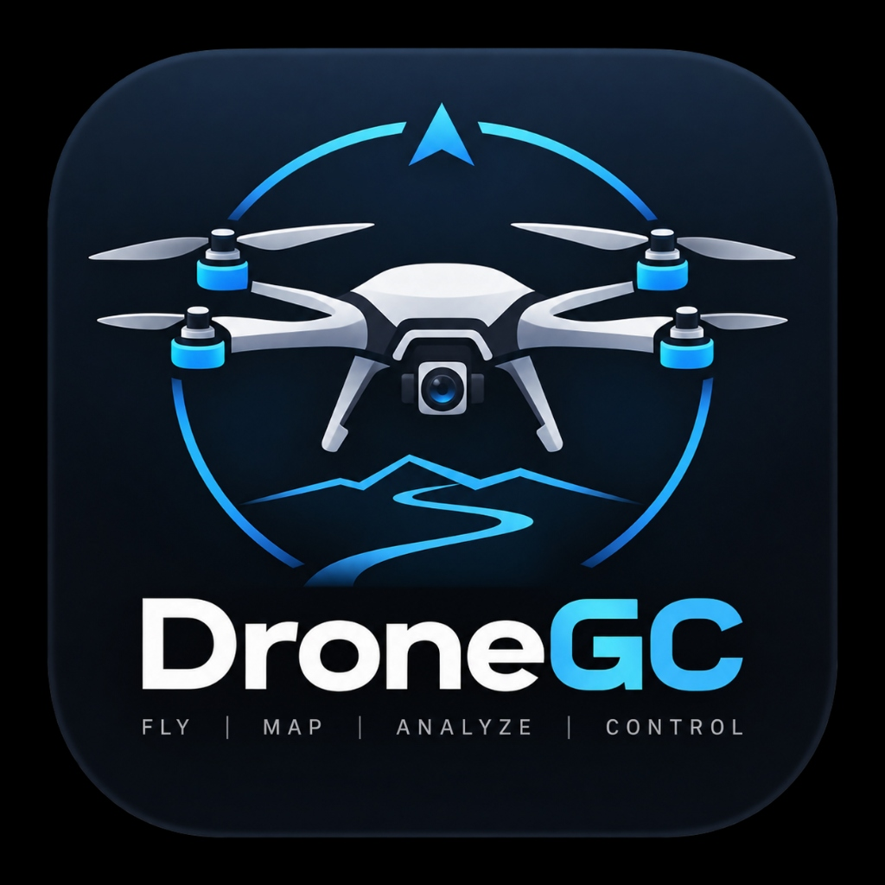

# DroneGCS

### Tactical Multi-UAV Ground Control Station
**Engineered for Autonomous UAV Operations, Fleet Telemetry, and Real-Time Mission Execution**

[](LICENSE)
[](https://github.com/Humobot1812/DroneGCS)
[](https://www.qt.io/)
[](https://isocpp.org/)
[](https://mavlink.io/)

<p align="center">
  <a href="#overview">Overview</a> •
  <a href="#interface-showcase">Interface Showcase</a> •
  <a href="#key-features">Key Features</a> •
  <a href="#px4-and-ardupilot-parity">Autopilot Architecture</a> •
  <a href="#system-architecture">Architecture</a> •
  <a href="#quick-start">Quick Start</a> •
  <a href="#building-from-source">Building from Source</a> •
  <a href="#developer">Developer</a> •
  <a href="#license">License</a>
</p>

</div>

---

## Overview

**DroneGCS** is a high-performance, tactical Ground Control Station (GCS) designed from the ground up for modern multi-rotor, fixed-wing, and VTOL uncrewed aerial vehicles. Built using **C++17**, **Qt 6**, **QML**, and **MAVLink v2**, DroneGCS delivers an ultra-responsive, military-inspired cockpit interface with millisecond telemetry latency, interactive geospatial situational awareness, live HD video pipelines, an autonomous mission planner, and an integrated **Tactical AI Copilot powered by Google Gemini AI**.

Whether conducting field operations with flight controllers (Pixhawk, Cube, ArduPilot, PX4) via USB/Telemetry Radios, connecting to Software-in-the-Loop (SITL) simulators over TCP/UDP, or orchestrating multi-vehicle fleet missions, DroneGCS provides total command, parameter tuning, and telemetry oversight.

---

## Interface Showcase

### Tactical Cockpit and Situational Awareness
The primary flight screen provides operators with a full-viewport situational display, combining satellite cartography with an avionics Primary Flight Display (PFD), real-time engine vitals, and tactical HUD overlays.

<div align="center">
  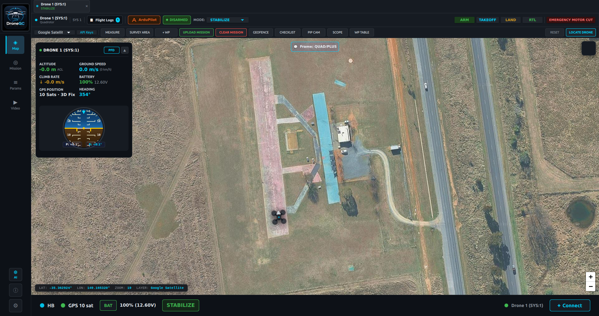
  <p><em>Primary tactical display: Real-time telemetry HUD, artificial horizon PFD, Google Satellite imagery, and quick command bar.</em></p>
</div>

---

### Tactical AI Copilot (Powered by Google Gemini AI)
DroneGCS features a native Tactical AI Copilot with complete UAV telemetry awareness and direct command execution authority. Operators can issue natural language directives, receive instant SITREP briefings, and query vehicle health in real time.

| AI Copilot Autonomous Mission Navigation | Natural Language Flight Commands (RTL Execution) |
| :---: | :---: |
| 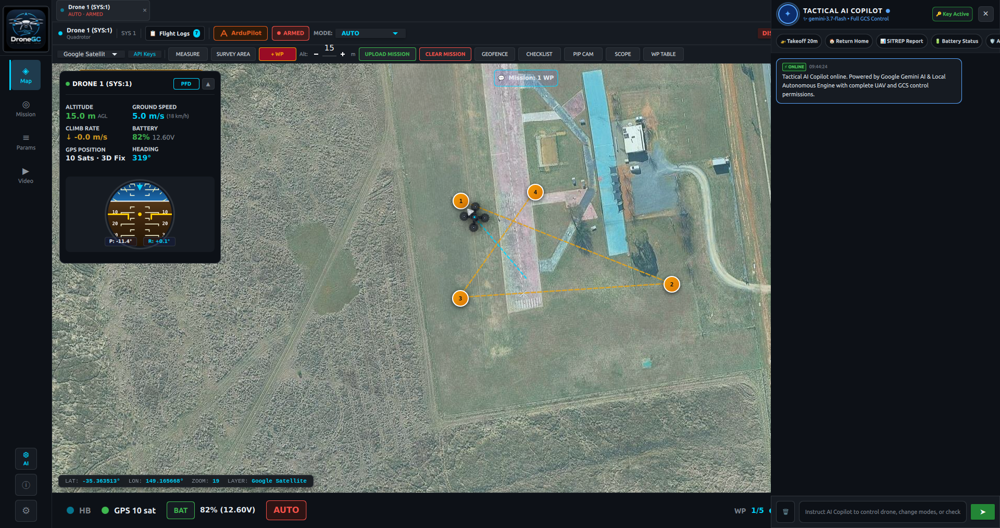 | 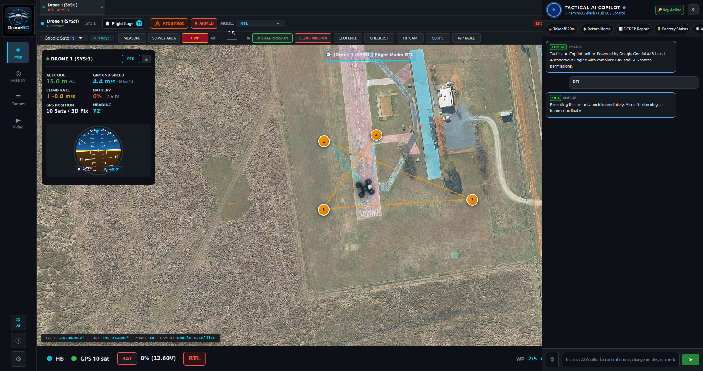 |
| *Real-time autonomous copilot tracking waypoint progress with Gemini reasoning.* | *Natural language RTL command execution with automated telemetry briefing.* |

---

### Waypoint Mission Planning and Real-Time Telemetry Oscilloscope
Plan, sequence, upload, and download complex waypoint missions with pinpoint accuracy. The integrated real-time Telemetry Oscilloscope plots altitude, climb rate, voltage, and groundspeed concurrently.

<div align="center">
  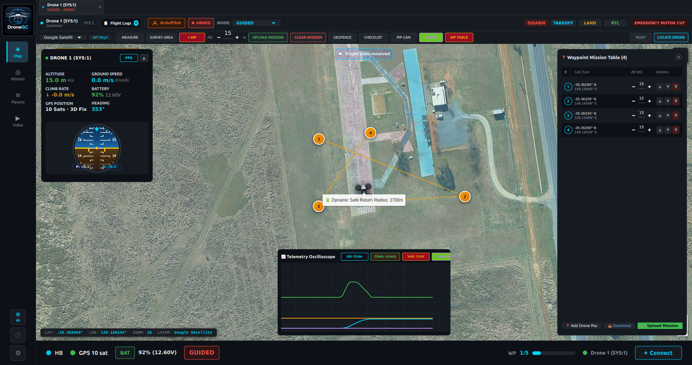
  <p><em>Waypoint Mission Table with dynamic safe return radius calculation and live multi-channel telemetry oscilloscope.</em></p>
</div>

---

### Safety Geofencing and Geospatial Layer Management
The Geofence Safety Console allows operators to establish cylindrical boundaries, altitude ceilings, and polygon keep-in/keep-out safety corridors. DroneGCS also automatically fetches and visualizes pre-existing onboard geofences from both ArduPilot and PX4 drones.

<div align="center">
  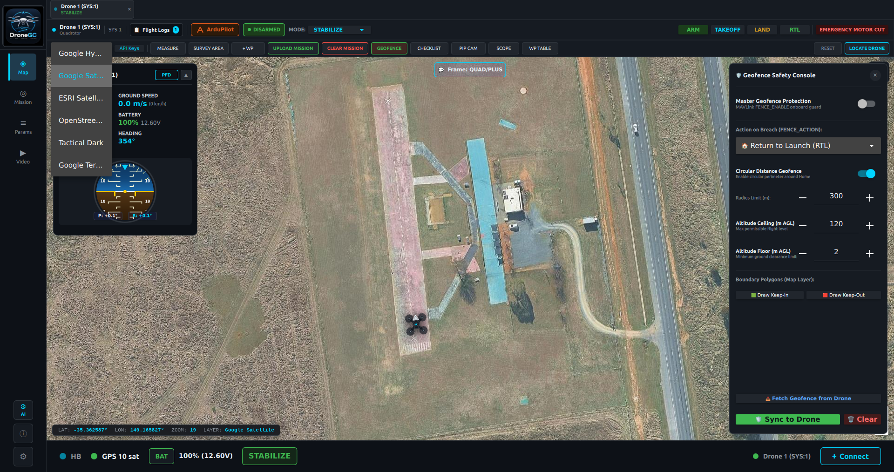
  <p><em>Geofence Safety Console: Master protection toggle, breach action selector, radius and altitude limits, and one-click fetch from autopilot.</em></p>
</div>

---

### Unified Flight Dynamics Tuning and Parameter Management
Fine-tune mission flight dynamics on the fly. The Unified Autopilot Tuning system bridges ArduPilot and PX4 parameter sets into a single intuitive control panel for Return-to-Launch (RTL) speed, yaw turn rate, and auto-yaw behavior.

<div align="center">
  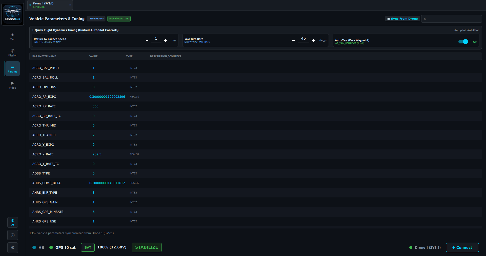
  <p><em>Unified Flight Dynamics Tuning: Instant adjustments for RTL speed, yaw rate, and waypoint auto-facing with full MAVLink parameter synchronization.</em></p>
</div>

---

### Autonomous Survey Missions and 3D Elevation Clearance Profile
Generate automated zigzag grid survey missions for agricultural analysis, surveillance, and photogrammetry. The interactive 3D terrain profile evaluates ground clearance and warns against Controlled Flight Into Terrain (CFIT).

<div align="center">
  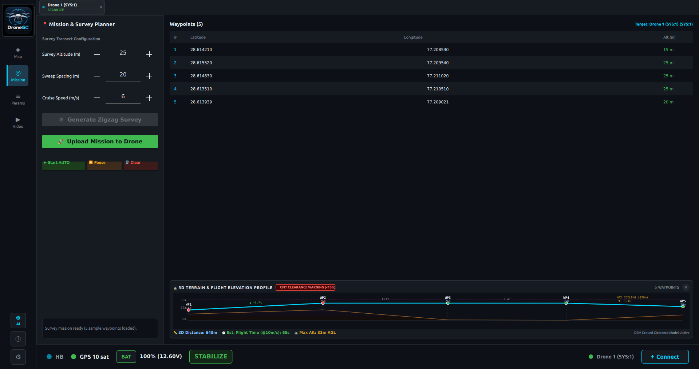
  <p><em>Mission Survey Planner: Transect grid spacing, cruise speed, and 3D terrain elevation profile with terrain clearance monitoring.</em></p>
</div>

---

### Pre-Flight Verification and Safeguarded Action Sliders
To eliminate accidental operator errors, critical vehicle states (Arming, Takeoff, Return-to-Launch, and Landing) utilize interactive slide-to-confirm controls with pre-flight sensor diagnostics.

| Pre-Flight Systems Checklist | Slide-to-Takeoff Clearance |
| :---: | :---: |
| 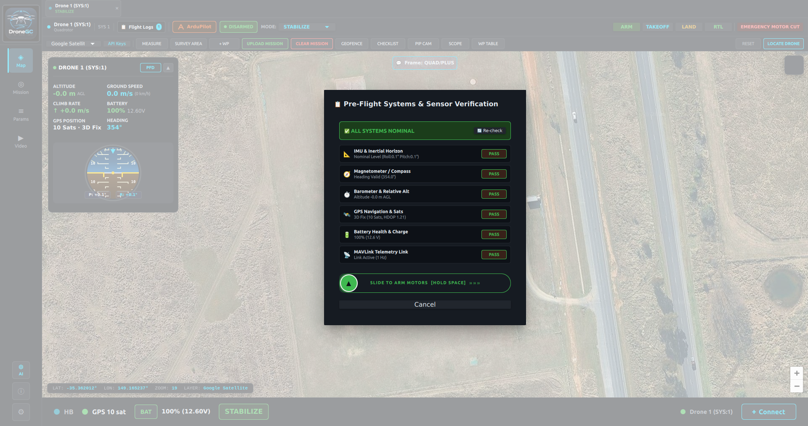 | 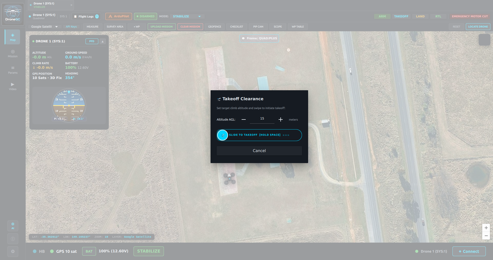 |
| *Automated pre-arm diagnostics verifying IMU, Magnetometer, Barometer, GPS fix, and telemetry health.* | *Altitude AGL target selector with slide-to-confirm takeoff execution.* |

| Return-to-Launch (RTL) Confirmation | Landing Clearance Confirmation |
| :---: | :---: |
|  | 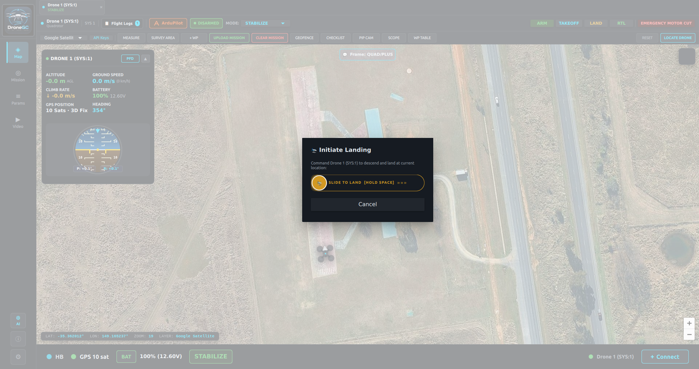 |
| *Slide-to-confirm Return-to-Launch failsafe execution.* | *Slide-to-confirm controlled vertical descent and landing.* |

---

### Flight Modes, Telemetry Logging, and System Settings

| Dynamic Autopilot Flight Modes | Flight Recorder and Telemetry Logs |
| :---: | :---: |
| 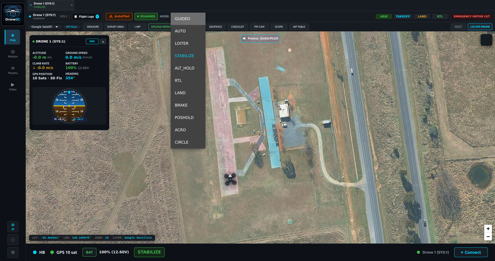 | 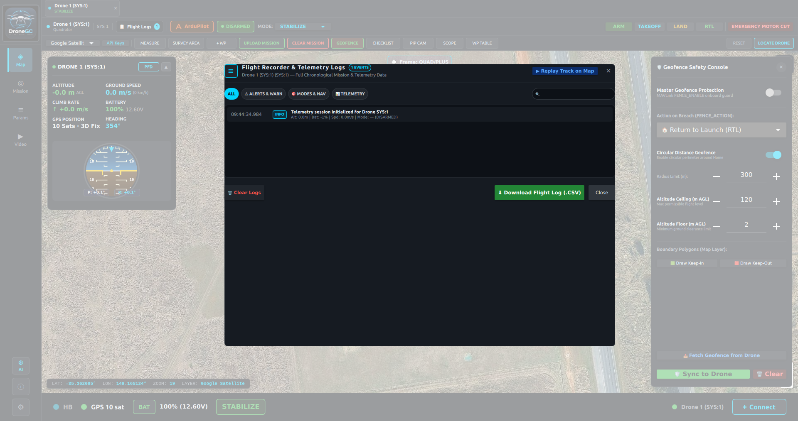 |
| *Dynamic mode selection with automatic migration between ArduPilot and PX4.* | *Chronological event logger with map track replay and CSV telemetry export.* |

| Flight Safety Configuration | Real-Time Voice Annunciator | Telemetry Configuration |
| :---: | :---: | :---: |
| 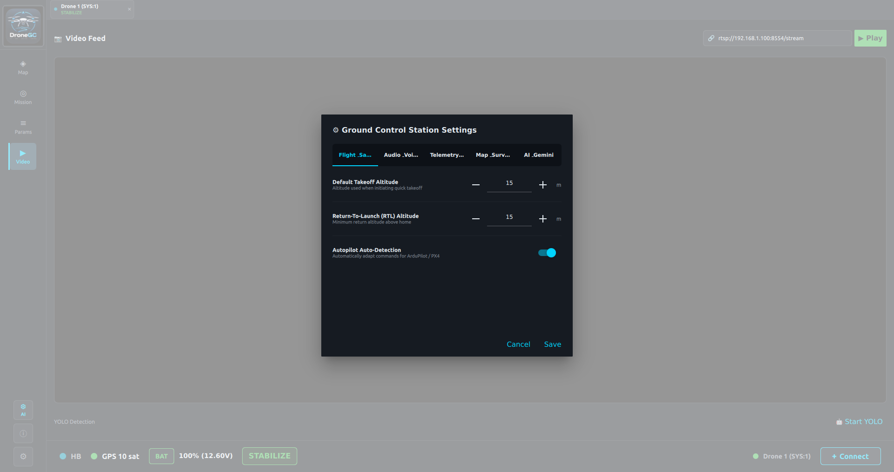 | 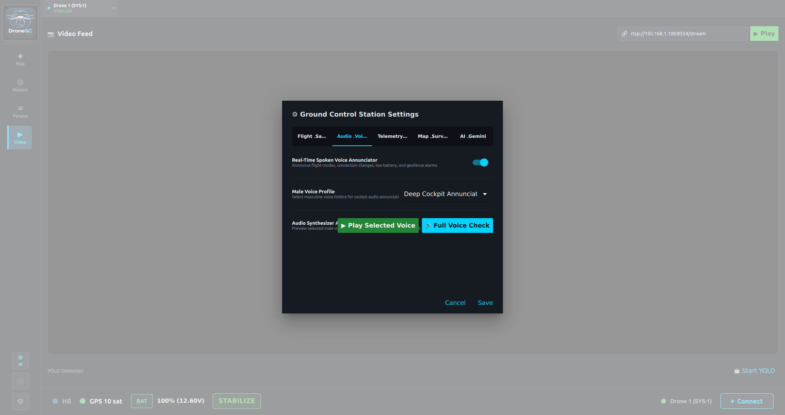 |  |
| *Default altitudes and autopilot auto-detection.* | *Tactical speech engine and vocal timbre profiles.* | *MAVLink broadcast ID and default ports.* |

| Map and Offline Cache Settings | Google Gemini AI Engine Setup | System Architecture and Credits |
| :---: | :---: | :---: |
| 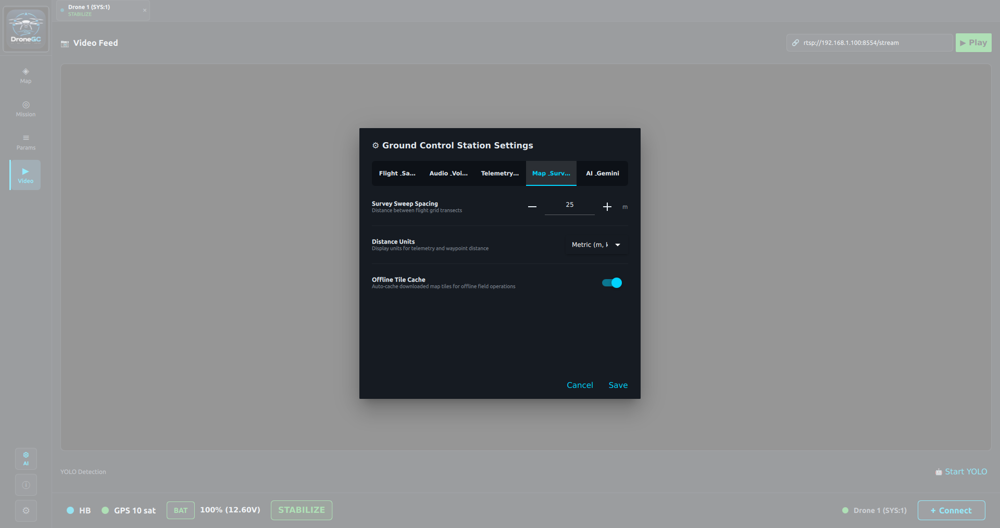 | 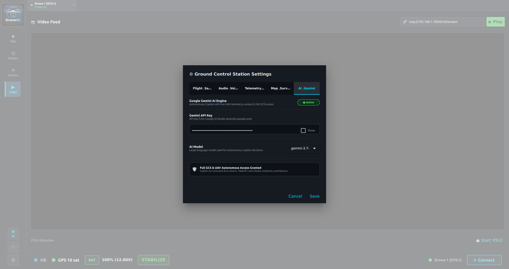 | 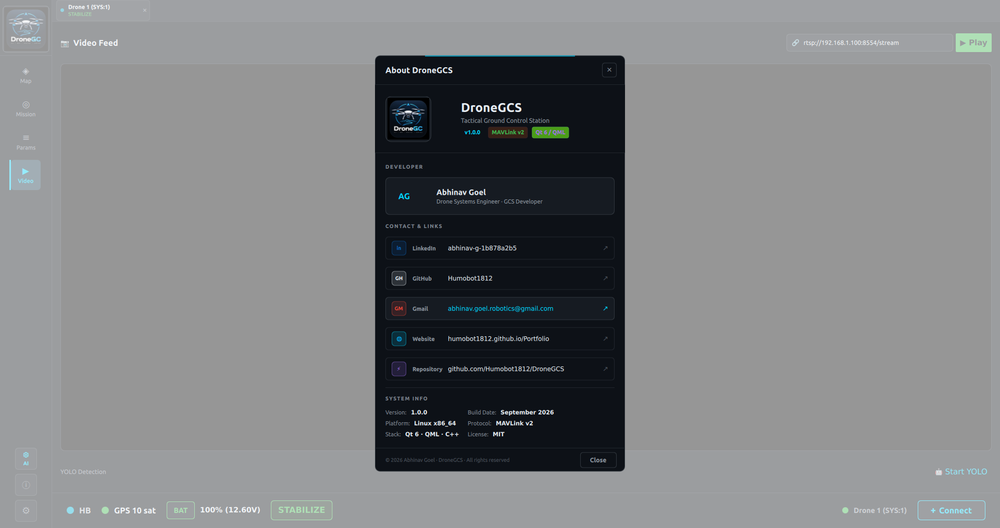 |
| *Offline tile caching and measurement units.* | *Gemini API configuration and autonomy controls.* | *Build architecture, Qt6/C++ runtime info.* |

---

## Key Features

### Multi-Drone Fleet and Swarm Management
* **Multi-Vehicle Support**: Connect, monitor, and command multiple drones concurrently with independent telemetry states.
* **Instant Vehicle Switching**: Seamlessly toggle active control between airframes via the fleet selector bar.
* **Live Fleet Status Overview**: At-a-glance monitoring of battery state, flight modes, satellite lock, and comms links across all active vehicles.

### Tactical Glass Cockpit and Primary Flight Display
* **Primary Flight Display (PFD)**: High-fps Artificial Horizon / Attitude Indicator with pitch ladder and roll scale.
* **Vertical Tape Gauges**: Real-time indicated airspeed, groundspeed, barometric altitude, and climb rate (variometer).
* **Compass Rose**: Dynamic heading tape with home vector, target waypoint bearing, and ground track visualization.
* **Subsystem Vital Signs**: Battery voltage, current draw, remaining capacity percentage, link signal quality (RSSI), GPS fix type (3D/RTK), satellite count, and HDOP/VDOP metrics.

### Tactical AI Copilot (Google Gemini AI)
* **Autonomous Intelligence**: Embedded copilot powered by Google Gemini AI with access to real-time UAV state and telemetry context.
* **Natural Language UAV Command**: Command takeoff, return-to-launch, mode transitions, or mission pause using conversational English.
* **Automated SITREP Reports**: Instant situational awareness summaries detailing position, battery endurance, navigation target, and safety status.

### Geospatial Tactical Map Engine
* **Interactive Mapping**: Powered by an embedded Leaflet/WebEngine core with seamless tile switching (Google Satellite, Google Hybrid, ESRI Satellite, OpenStreetMap, Tactical Dark, Google Terrain).
* **Dynamic Vehicle Markers**: Real-time heading-aligned aircraft icons, home position markers, and animated breadcrumb trails.
* **Interactive Waypoint Editor**: Point-and-click waypoint sequencing with altitude, speed, acceptance radius, and loiter time controls.
* **Survey and Grid Missions**: Automated flight path generation for aerial mapping and reconnaissance.
* **Mission Elevation Profile**: Interactive elevation chart displaying planned flight trajectory against terrain data with clearance warnings.

### Universal 1-Click Auto-Connect
* **Multi-Transport Scanning Engine**:
  * **Serial**: Automatically detects and prioritizes flight controller interfaces (`/dev/ttyACM*`, `/dev/ttyUSB*`, FTDI, SiK radios) at 57600 and 115200 baud.
  * **UDP**: Listens concurrently across all standard MAVLink telemetry ports (`14550`, `14551`, `14552`, `18570`).
  * **TCP**: Probes ArduPilot and PX4 SITL simulator endpoints (`127.0.0.1:5760`, `5761`, `5762`, `14550`).
* **Visual Interface Dialog**: Dedicated tabs for Serial, UDP, and TCP manual connections alongside 1-click Auto-Connect.

| Serial Connection | UDP Inbound Connection | TCP SITL Simulator Connection |
| :---: | :---: | :---: |
| 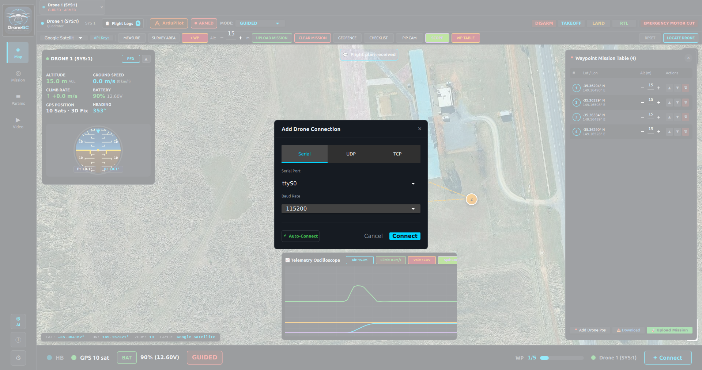 |  | 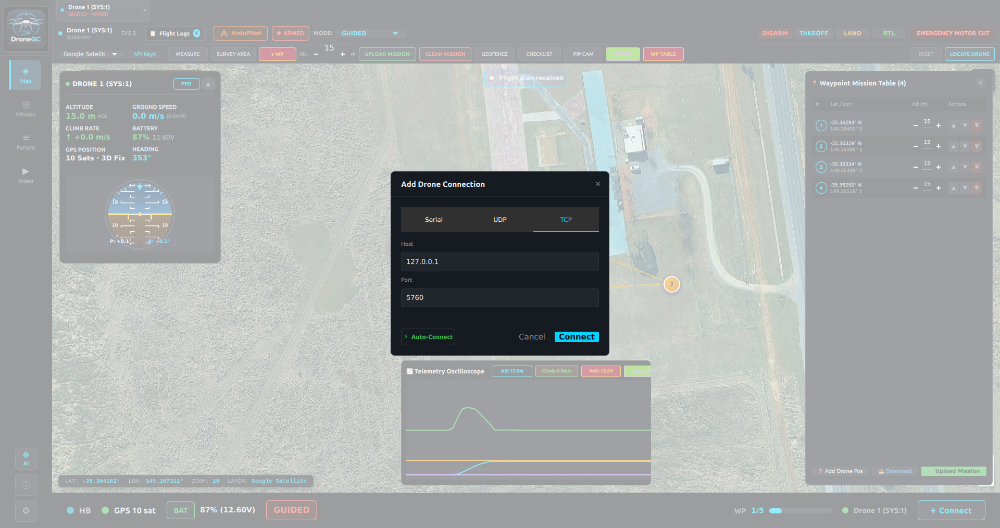 |

### Safety, Geofencing, and Pre-Flight Diagnostics
* **Interactive Geofence Console**: Configure circular and polygonal keep-in/keep-out safety boundaries with ceiling and floor constraints.
* **Bidirectional Geofence Sync**: Upload safety fences directly to the autopilot, or automatically download pre-existing geofences stored on the drone.
* **Slide-to-Confirm Arming**: Safeguarded tactile sliders for critical flight commands (Arm, Disarm, Takeoff, Return-to-Launch, Land, Emergency Kill).
* **Pre-Flight Checklist Engine**: Interactive pre-arm verification covering IMU calibration, GPS lock, battery threshold, RC link, and motor readiness.
* **Spoken Voice Annunciator**: Auditory callouts for critical flight events (Arming state, flight mode transitions, battery warnings, geofence breaches).

### Real-Time Analytics and Flight Log Replay
* **Live Telemetry Oscilloscope**: Multi-channel real-time charting for altitude, airspeed, battery voltage, climb rate, and current.
* **Flight Playback and Recording**: Review and analyze historic missions with variable-speed playback, scrub bar, and telemetry overlays.
* **CSV Log Export**: Export comprehensive flight logs for post-mission engineering analysis.

### Live HD Video Pipeline
* **GStreamer Integration**: Ultra-low-latency video reception supporting RTSP, UDP RTP, and H.264 video streams.
* **Picture-in-Picture (PiP)**: Draggable, floating video overlay directly over the tactical map.

---

## Autopilot Architecture

DroneGCS provides native, zero-configuration interoperability across both **ArduPilot** and **PX4 Autopilot** flight stacks.

### Dynamic Flight Mode Translation
The GCS inspects incoming MAVLink `HEARTBEAT` messages to identify the target autopilot architecture (`MAV_AUTOPILOT_ARDUPILOTMEGA` vs `MAV_AUTOPILOT_PX4`). Flight mode menus dynamically populate according to the connected system:

* **ArduPilot Modes**: `GUIDED`, `AUTO`, `LOITER`, `STABILIZE`, `ALT_HOLD`, `RTL`, `LAND`, `BRAKE`, `POSHOLD`, `ACRO`, `CIRCLE`
* **PX4 Modes**: `HOLD`, `LOITER`, `POSCTL`, `ALTCTL`, `MISSION`, `TAKEOFF`, `RTL`, `LAND`, `OFFBOARD`, `MANUAL`, `ACRO`, `STABILIZED`

Flight mode commands are encoded using both modern `MAV_CMD_DO_SET_MODE` command protocols and standard `SET_MODE` packets with PX4 custom main/sub mode bitfields to ensure zero command rejection.

### Unified Flight Dynamics Parameter Bridge
The Quick Flight Dynamics Tuning panel abstracts underlying autopilot parameters:

| Dynamic Setting | ArduPilot Parameter | PX4 Autopilot Parameter | Description |
|:---|:---|:---|:---|
| **Return-to-Launch Speed** | `RTL_SPEED` / `WPNAV_SPEED` | `MPC_XY_CRUISE` | Autonomous transit speed when returning to home coordinate |
| **Yaw Turn Rate** | `WPNAV_YAW_RATE` | `MPC_YAWRAUTO_MAX` | Maximum angular turn rate during autonomous heading adjustments |
| **Auto-Yaw Behavior** | `WP_YAW_BEHAVIOR` (1 vs 0) | `MIS_YAW_TGT` | Determines whether the drone faces the active waypoint or maintains heading |

### Bidirectional Mission and Geofence Protocol
* **Mission Synchronization**: Implements `MISSION_REQUEST_LIST`, `MISSION_ITEM_INT`, and `MISSION_ACK` (handling modern MAVLink opaque identifiers) for bidirectional waypoint upload and download.
* **Geofence Auto-Fetch**: When connected, the GCS issues geofence inspection commands (`MAV_MISSION_TYPE_FENCE` and parameter reads) to reconstruct pre-existing fences onto the tactical map without manual user intervention.

---

## System Architecture

```
+------------------------------------------------------------------------+
|                        DroneGCS User Interface                         |
|   Tactical Cockpit  |  Map Engine  |  Mission Planner  |  AI Copilot   |
+------------------------------------------------------------------------+
|                       Qt 6 / QML Presentation Layer                     |
|    Quick Controls 2 (Tactical Dark)  |  Custom Canvas / SVG Visuals    |
+-----------------------+------------------------+-----------------------+
|    Telemetry Grapher  |  Geofence & Safety     |  Voice Annunciator    |
+-----------------------+------------------------+-----------------------+
|                           C++17 Core Engine                            |
|  +--------------------+ +--------------------+ +---------------------+ |
|  |   DroneManager     | |   DroneVehicle     | |   MissionPlanner    | |
|  |  Fleet Management  | |  Telemetry & State | |  Waypoint & Plans   | |
|  +---------+----------+ +---------+----------+ +----------+----------+ |
+------------+----------------------+-----------------------+------------+
|   Transport Subsystem | MAVLink v2 Parser/Serializer      | Video Subsys|
|   Serial (ttyACM/USB) | HEARTBEAT, ATTITUDE, GLOBAL_POS   | GStreamer  |
|   UDP (14550/14551..) | MISSION_ITEM_INT, COMMAND_LONG    | RTSP / UDP |
|   TCP (5760/5761..)   | SYS_STATUS, VFR_HUD, BATTERY_STAT | H.264 / PiP|
+-----------------------+-----------------------------------+------------+
```

---

## Quick Start

### Running the AppImage (Recommended)

DroneGCS is distributed as a completely self-contained Linux AppImage with bundled Qt 6 runtime, WebEngine, and dependencies:

```bash
# 1. Ensure the AppImage is executable
chmod +x DRONE_GCS-x86_64.AppImage

# 2. Grant serial port permissions (required for USB flight controllers)
sudo usermod -aG dialout $USER

# 3. Launch DroneGCS
./DRONE_GCS-x86_64.AppImage
```

> **Note**: After adding your user to the `dialout` group, log out and log back in once for permissions to take effect.

---

## Building from Source

### Prerequisites

* **Operating System**: Linux (Ubuntu 20.04 / 22.04 / 24.04 or compatible)
* **Compiler**: GCC / G++ supporting C++17
* **Build System**: CMake (>= 3.16) and Make / Ninja
* **Framework**: Qt 6 (6.2.4 or higher) with components:
  * `Core`, `Gui`, `Quick`, `Qml`, `Network`, `SerialPort`, `WebEngineQuick`
* **Multimedia**: GStreamer 1.0 development libraries

Install required dependencies on Debian/Ubuntu:
```bash
sudo apt-get update
sudo apt-get install -y \
    build-essential \
    cmake \
    git \
    libgstreamer1.0-dev \
    libgstreamer-plugins-base1.0-dev \
    gstreamer1.0-plugins-good \
    gstreamer1.0-plugins-bad \
    libnss3 \
    libxcomposite-dev \
    libxdamage-dev \
    libxrandr-dev \
    libxcursor-dev \
    libxi-dev \
    libxtst-dev
```

### Compiling

```bash
# Clone the repository
git clone https://github.com/Humobot1812/DroneGCS.git
cd DroneGCS

# Run the automated build script (points to Qt 6.2.4 or your Qt installation)
./build.sh

# Or build manually with CMake:
mkdir -p build && cd build
cmake .. -DCMAKE_PREFIX_PATH="$HOME/Qt/6.2.4/gcc_64" -DCMAKE_BUILD_TYPE=Release
cmake --build . --parallel $(nproc)

# Run the binary
./DRONE_GCS
```

---

## AppImage Packaging

DroneGCS includes a complete standalone AppImage packaging toolchain with bundled Chromium WebEngine runtime, Qt plugins, and OpenSSL libraries:

```bash
# Generate the standalone AppImage
./scripts/create_appimage.sh

# The output AppImage will be generated at:
# DRONE_GCS-x86_64.AppImage
```

---

## Connecting to Vehicles

| Connection Type | Default Parameters | Typical Target |
|:---|:---|:---|
| **USB Serial** | `/dev/ttyACM0`, `57600` / `115200` baud | Pixhawk, Cube, Matek, ArduPilot / PX4 via USB |
| **Telemetry Radio** | `/dev/ttyUSB0`, `57600` baud | SiK Radio, Holybro, RFD900, 3DR Radio |
| **UDP Inbound** | Port `14550` or `14551` | Companion computers (Raspberry Pi), MAVProxy, SITL |
| **TCP Client** | `127.0.0.1:5760` | ArduPilot / PX4 SITL simulator instance 0 |

Click **Auto-Connect** in the connection dialog to probe and attach to available vehicles on all interfaces simultaneously.

---

## Developer

**Abhinav Goel**  
*Drone Systems Engineer · Ground Control Station Developer*

* Website: [humobot1812.github.io/Portfolio](https://humobot1812.github.io/Portfolio/)
* LinkedIn: [abhinav-g-1b878a2b5](https://www.linkedin.com/in/abhinav-g-1b878a2b5/)
* GitHub: [@Humobot1812](https://github.com/Humobot1812)
* Email: [abhinav.goel.robotics@gmail.com](mailto:abhinav.goel.robotics@gmail.com)
* Repository: [Humobot1812/DroneGCS](https://github.com/Humobot1812/DroneGCS)

---

## License

This project is licensed under the **MIT License** — see the [LICENSE](LICENSE) file for complete details.

```
Copyright (c) 2026 Abhinav Goel
```
